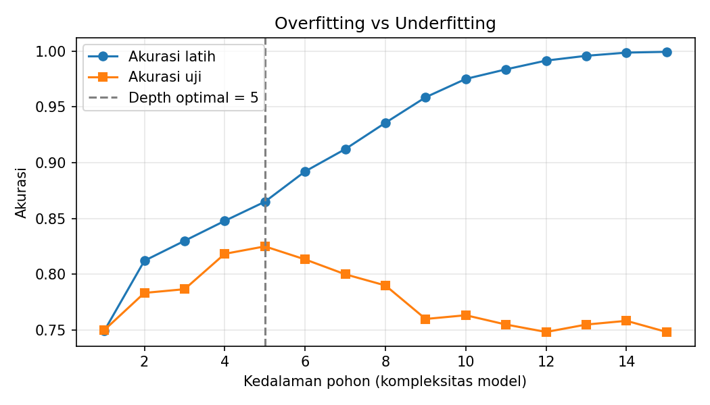
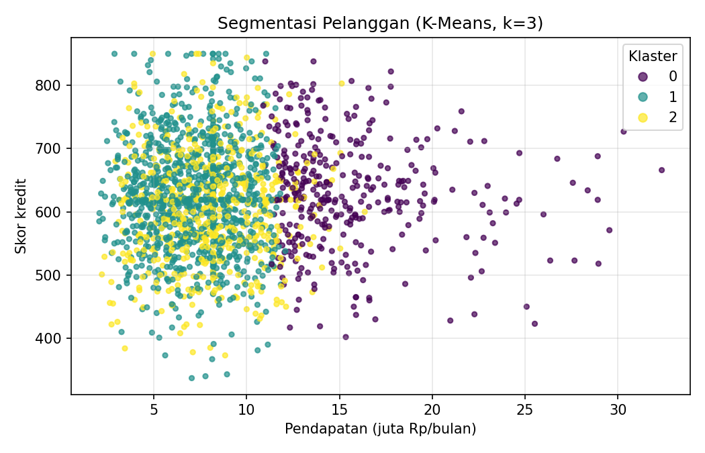
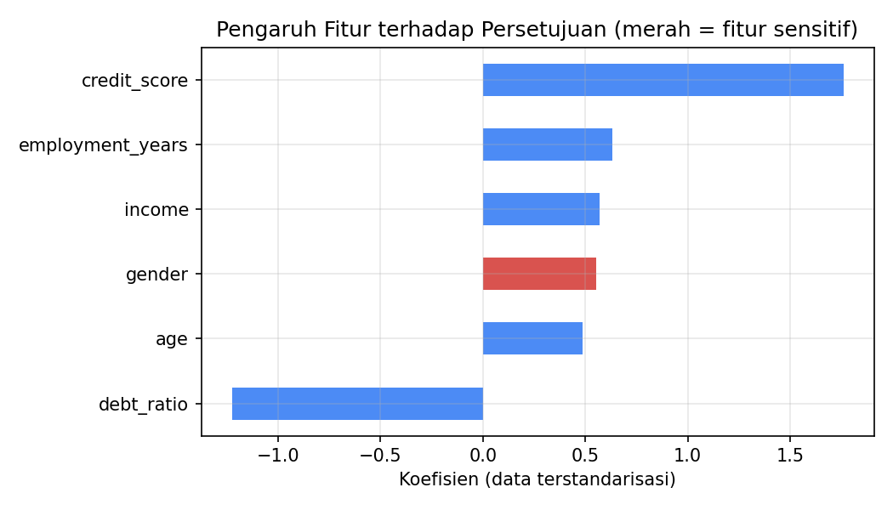

<div align="center">

# 🏦 Prediksi Persetujuan Pinjaman dengan Machine Learning

### Studi Kasus: Dari *Rule-Based* ke *Data-Driven*


</div>

---

## 📑 Daftar Isi
1. [Latar Belakang](#-latar-belakang)
2. [Rumusan Masalah & Tujuan](#-rumusan-masalah--tujuan)
3. [Batasan Masalah](#-batasan-masalah)
4. [Keterkaitan dengan Materi](#-keterkaitan-dengan-materi)
5. [Dataset](#-dataset)
6. [Struktur Proyek](#-struktur-proyek)
7. [Cara Menjalankan](#-cara-menjalankan)
8. [Alur Kerja (Workflow)](#-alur-kerja-workflow)
9. [Hasil & Analisis](#-hasil--analisis)
10. [Kesimpulan](#-kesimpulan)
11. [Keterbatasan & Pengembangan](#-keterbatasan--pengembangan)

---

## 📌 Latar Belakang

Pemrograman tradisional bergantung pada aturan *if-then* yang ditulis manusia. Pada
sistem persetujuan pinjaman, misalnya: *"jika skor kredit ≥ 580 dan rasio utang < 50%
maka setujui"*. Pendekatan ini sulit disesuaikan ketika pola data menjadi kompleks.

*Machine Learning* membalik cara kerjanya: algoritma **belajar menemukan aturan
sendiri dari data**. Namun, ketergantungan pada data juga membawa risiko, yaitu
**bias**. Jika data historis bersifat diskriminatif, model akan ikut diskriminatif.

Studi kasus ini mendemonstrasikan seluruh gagasan tersebut dalam satu proyek kecil
yang mudah dijalankan.

## 🎯 Rumusan Masalah & Tujuan

**Rumusan masalah**
1. Seberapa besar keunggulan pendekatan *data-driven* dibanding *rule-based* pada kasus persetujuan pinjaman?
2. Bagaimana *overfitting* dan *underfitting* muncul pada model yang kompleksitasnya berbeda?
3. Apakah data historis yang bias menghasilkan model yang bias, dan bagaimana mitigasinya?

**Tujuan**
- Membandingkan pendekatan *rule-based* dan *Supervised Learning*.
- Memperlihatkan *overfitting* vs *underfitting* secara visual.
- Menerapkan *Unsupervised Learning* untuk segmentasi pelanggan.
- Mengukur bias gender dan menunjukkan salah satu cara mitigasinya.
- Menerapkan prinsip *Explainable AI* lewat interpretasi koefisien model.

## 🚧 Batasan Masalah

| # | Batasan |
|---|---------|
| 1 | Dataset bersifat **sintetis** (dibangkitkan program), bukan data bank sungguhan. |
| 2 | Jumlah data **2.000 baris** dengan **6 fitur** (usia, pendapatan, skor kredit, rasio utang, lama bekerja, gender). |
| 3 | Tugas utama adalah **klasifikasi biner** (disetujui / ditolak). |
| 4 | Algoritma dibatasi pada **Logistic Regression**, **Decision Tree**, dan **K-Means**. *Deep Learning* tidak dibahas. |
| 5 | Evaluasi memakai **akurasi** dan **selisih tingkat persetujuan antar gender**. Metrik lain (F1, AUC) tidak dibahas agar tetap sederhana. |
| 6 | Analisis bias dibatasi pada satu atribut sensitif, yaitu **gender**. |
| 7 | *Reinforcement Learning* dan *Semi-supervised Learning* hanya dibahas secara konsep, tidak diimplementasikan. |
| 8 | Hasil bersifat **edukatif** dan tidak boleh dipakai untuk keputusan kredit nyata. |

## 🔗 Keterkaitan dengan Materi

| Konsep dari pemateri | Implementasi di proyek ini |
|---|---|
| *Rule-based* → *Data-driven* | Bagian 2 & 3 di `main.py`: aturan manual vs model terlatih |
| *Supervised Learning* (klasifikasi) | Logistic Regression & Decision Tree |
| *Unsupervised Learning* (clustering) | K-Means untuk segmentasi pelanggan |
| Workflow ML | Pembersihan data kosong → split latih/uji → pelatihan → evaluasi |
| *Overfitting* & *Underfitting* | Kurva akurasi terhadap kedalaman pohon |
| Bias data & etika | Perbandingan tingkat persetujuan perempuan vs laki-laki |
| *Explainable AI* | Grafik koefisien fitur pada model logistik |
| *Reinforcement* & *Semi-supervised* | Hanya konsep (di luar batasan masalah) |

## 🗂️ Dataset

Dibangkitkan oleh `src/generate_data.py` dengan *seed* tetap sehingga hasilnya **dapat direproduksi**.

| Fitur | Keterangan |
|---|---|
| `age` | Usia pemohon (21–60) |
| `income` | Pendapatan per bulan (juta Rp) |
| `credit_score` | Skor kredit (300–850) |
| `debt_ratio` | Rasio cicilan terhadap pendapatan |
| `employment_years` | Lama bekerja (tahun) |
| `gender` | 0 = perempuan, 1 = laki-laki |
| `approved` | **Target**: 1 = disetujui, 0 = ditolak |

Dua "masalah" sengaja ditanam agar sesuai materi:
- **~5% data kosong** pada `income` dan `credit_score` (latihan pra-pemrosesan).
- **Bias historis**: pada pembentukan label, laki-laki diberi keuntungan tambahan (latihan etika).

## 📁 Struktur Proyek

```
ml-loan-case-study/
├── README.md              # Dokumentasi (file ini)
├── requirements.txt       # Dependensi Python
├── .gitignore
├── data/
│   └── loan_data.csv      # Dataset hasil generate
├── src/
│   ├── generate_data.py   # Pembangkit dataset sintetis
│   └── main.py            # Seluruh alur studi kasus
└── outputs/
    ├── hasil.txt          # Log hasil eksekusi
    ├── overfitting_curve.png
    ├── clusters.png
    └── feature_importance.png
```

## ▶️ Cara Menjalankan

```bash
# 1. Clone repositori
git clone https://github.com/SxCentauri/ml-loan-case-study.git
cd ml-loan-case-study

# 2. (Opsional) buat virtual environment
python -m venv .venv
source .venv/bin/activate        # Windows: .venv\Scripts\activate

# 3. Pasang dependensi
pip install -r requirements.txt

# 4. Jalankan dari folder utama proyek
python src/main.py
```

Grafik tersimpan otomatis di folder `outputs/`.

## 🔄 Alur Kerja (Workflow)

```
Data → Pra-pemrosesan → Split Latih/Uji → Pelatihan → Evaluasi → Analisis Bias → Interpretasi
```

1. **Pengumpulan data**: dataset sintetis 2.000 pemohon.
2. **Pra-pemrosesan**: data dibagi **terlebih dahulu** (70% latih, 30% uji), baru data kosong diisi dengan median dari data latih. Urutan ini mencegah *data leakage*.
3. **Pelatihan**: Logistic Regression dan Decision Tree.
4. **Evaluasi**: akurasi pada data uji yang belum pernah dilihat model.
5. **Analisis bias & interpretasi**: bandingkan perlakuan antar gender dan baca koefisien model.

## 📊 Hasil & Analisis

> Seluruh angka di bawah berasal dari eksekusi `python src/main.py` (lihat `outputs/hasil.txt`).

### 1️⃣ Rule-Based vs Data-Driven

| Pendekatan | Akurasi Uji |
|---|:---:|
| Tebak "disetujui" untuk semua (baseline) | 75,0% |
| *Rule-based* (aturan manual if-then) | 64,7% |
| Decision Tree (kedalaman 4) | 81,8% |
| **Logistic Regression** | **85,2%** |

**Analisis:** aturan manual bahkan kalah dari baseline sederhana, sedangkan model yang
belajar dari data meningkatkan akurasi sekitar 20 poin persentase dibanding aturan manual.
Manusia sulit menimbang banyak variabel sekaligus dengan bobot yang tepat.

### 2️⃣ Overfitting vs Underfitting



| Kedalaman Pohon | Akurasi Latih | Akurasi Uji | Kondisi |
|:---:|:---:|:---:|---|
| 1 | 74,9% | 75,0% | ⚠️ *Underfitting*: terlalu sederhana |
| 5 | 86,5% | 82,5% | ✅ Optimal |
| 15 | 99,9% | 74,8% | ❌ *Overfitting*: menghafal data latih |

**Analisis:** pada kedalaman 15, model nyaris sempurna pada data latih (99,9%) tetapi
akurasinya jatuh di data uji (74,8%). Inilah ciri khas *overfitting* yang dijelaskan pemateri:
sistem tampak sempurna saat pelatihan namun gagal pada data dunia nyata.

### 3️⃣ Unsupervised Learning: Segmentasi Pelanggan



| Klaster | Pendapatan | Skor Kredit | Rasio Utang | Jumlah | Interpretasi |
|:---:|:---:|:---:|:---:|:---:|---|
| 0 | 15,5 | 630 | 0,29 | 354 | Berpendapatan tinggi |
| 1 | 7,2 | 625 | 0,22 | 1.030 | Menengah, utang rendah |
| 2 | 8,0 | 606 | 0,53 | 616 | Beban utang tinggi (berisiko) |

**Analisis:** K-Means menemukan tiga kelompok tanpa label apa pun. Nama dan interpretasi
klaster ditentukan manusia berdasarkan profil rata-ratanya.

### 4️⃣ Analisis Bias (Etika)

| Skenario | Disetujui (Perempuan) | Disetujui (Laki-laki) | Selisih |
|---|:---:|:---:|:---:|
| Data historis (label asli) | 68,3% | 81,4% | +13,2% |
| Model **dengan** fitur gender | 75,8% | 84,4% | +8,6% |
| Model **tanpa** fitur gender | 79,9% | 79,8% | -0,1% |

**Analisis:** data historis sudah memperlakukan perempuan lebih buruk, dan model yang
diberi fitur gender **menyalin** ketimpangan tersebut. Setelah fitur gender dibuang,
selisihnya hilang tanpa mengorbankan akurasi (85,5%).

> ⚠️ **Catatan penting:** pada data ini tidak ada fitur lain yang berkorelasi dengan
> gender, sehingga menghapus kolom gender sudah cukup. Pada data nyata, fitur lain bisa
> menjadi *proxy* (perwakilan) gender, jadi mitigasi bias membutuhkan pengujian yang lebih mendalam.

### 5️⃣ Explainable AI



Koefisien Logistic Regression menunjukkan alasan di balik keputusan model:
**skor kredit** adalah faktor paling positif, **rasio utang** paling negatif, dan fitur
**gender** (merah) masih punya pengaruh positif. Ini bukti transparan bahwa model
memakai atribut yang seharusnya tidak relevan.

## ✅ Kesimpulan

1. Pendekatan **data-driven** jauh lebih akurat daripada aturan manual pada kasus ini.
2. Kompleksitas model harus **seimbang**: terlalu sederhana menyebabkan *underfitting*, terlalu kompleks menyebabkan *overfitting*.
3. **Kualitas dan keadilan data** menentukan keadilan model: data bias menghasilkan model bias.
4. Model yang **dapat dijelaskan** memungkinkan kita mendeteksi masalah seperti bias lebih cepat.
5. Sejalan dengan pesan pemateri, AI harus *human-centered*, aman, dan transparan, dan manusia tetap bertanggung jawab atas keputusan akhirnya.

## 🔭 Keterbatasan & Pengembangan

- Data sintetis belum mewakili kerumitan data nyata.
- Pengembangan lanjutan: metrik F1/AUC, validasi silang (*cross-validation*), Random Forest, SHAP/LIME untuk *Explainable AI*, dan metrik keadilan formal (*demographic parity*, *equal opportunity*).

---

<div align="center">

*Dibuat sebagai tugas pembelajaran Machine Learning. Dibuat dengan 🐍 Python.*

</div>
